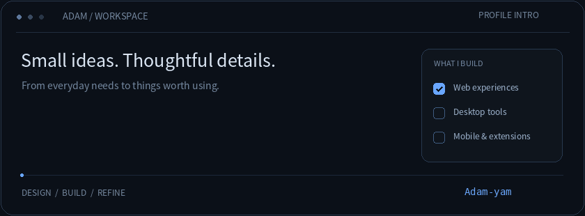

<h1 align="center">Hi, I'm Adam.</h1>

I make tools that help people enjoy what they love and simplify everyday tasks. Fan websites, desktop companions, mobile apps, and browser extensions.

<a href="https://adam-yam.github.io/SCENE-FLIX/">Visit SCENE-FLIX</a> &nbsp; · </a> &nbsp; · &nbsp; <a href="https://github.com/Adam-yam?tab=repositories">All repositories</a>

 

## It starts with a small need

Sometimes a video is hard to find, a useful setting takes too many steps to reach, or an everyday screen could feel a little more personal. Those are the moments that make me want to build something.

As a RESCENE fan, I run **SCENE-FLIX**, bringing content together and making it easier for other fans to explore and share. I also work on small projects such as a desktop character that reacts to typing, an app that opens fingerprint-related settings, and an extension that changes the YouTube viewing experience.

| Interest | What I want to make |
| :--- | :--- |
| Fan content and communities | Places to find, enjoy, and share content |
| Everyday utilities | Tools that reduce repetitive or inconvenient steps |
| Interfaces and interaction | Clear information and motion that feels natural |

 

## Selected projects

### 01 &nbsp; SCENE-FLIX

**A place to find, collect, and revisit RESCENE videos**

A website that brings together music show performances, external appearances, original content, and fan channels. It helps fans spend less time searching across channels and more time enjoying the content they came for.

- **Content discovery** — Browse categories, search videos, and explore related series.
- **Useful fan information** — Find schedules, news, and chart information alongside videos.
- **Personal collections** — Save favorites to return to later.
- **Responsive layouts** — Interfaces and navigation tailored to desktop and mobile.

Website · Fan content archive

[Visit website ↗](https://adam-yam.github.io/SCENE-FLIX/) &nbsp; [View repository ↗](https://github.com/Adam-yam/SCENE-FLIX)

 

### 02 &nbsp; Typing Remini

**A little response to every keystroke**

A desktop companion featuring Remini characters that react to keyboard input. The character types along while you work, then gets sleepy or falls asleep when you step away.

- **Character selection** — Choose between several Remini characters in 2D and 3D styles.
- **Typing and idle motion** — Different reactions for active typing and inactivity.
- **Motion controls** — Adjust the bouncing effect to your preference.
- **Convenience features** — Game mode and update checking.

Windows · Desktop companion

[View repository ↗](https://github.com/Adam-yam/Typing-Remini) &nbsp; [View releases ↗](https://github.com/Adam-yam/Typing-Remini/releases)

 

### 03 &nbsp; SenseTouch

**Easier access to fingerprint improvement settings on Samsung devices**

An Android app that opens a hidden fingerprint-related settings screen on supported Samsung devices. It checks Shizuku connectivity and permissions, then provides a simple interface for accessing the feature.

- **Connection status** — Check Shizuku connectivity and required permissions.
- **Device support checks** — Check Samsung device and system compatibility.
- **Fingerprint selection** — Select a fingerprint entry and launch the relevant feature.
- **Failure guidance** — Show information when the feature cannot be launched.

Android · Samsung device utility

Support varies by device and One UI version. The app does not guarantee a particular improvement in fingerprint recognition.

[View repository ↗](https://github.com/Adam-yam/SenseTouch) &nbsp; [View releases ↗](https://github.com/Adam-yam/SenseTouch/releases)

 

### 04 &nbsp; Ambient Light for YT · KR

**Extend the colors of a YouTube video beyond its frame**

A Korean-localized adaptation of Ambient Light for YouTube, with changes focused on settings and usability. Customize the ambient effect around the video to suit your viewing preferences.

- **Korean settings** — Options organized for Korean-speaking users.
- **Presets** — Pick a look without adjusting every value individually.
- **Fine adjustments** — Customize blur, spread, and other visual settings.
- **Live application** — See setting changes while watching a video.

Browser extension · Korean localization and usability improvements

[View repository ↗](https://github.com/Adam-yam/Ambient_Light_for_YT_KR)

 

### 05 &nbsp; SCENE-grid

**Slice an image into a grid for your Galaxy Quick Settings panel**

An image-slicing tool for customizing Samsung Galaxy One UI's Quick Settings panel. It helps prepare image pieces for layouts used with Good Lock's QuickStar.

- **Grid slicing** — Split a single image into pieces that fit a defined grid.
- **Customization preparation** — Prepare images for a personal Quick Settings layout.

Image utility · Galaxy customization

[View repository ↗](https://github.com/Adam-yam/SCENE-grid)

 

## What matters to me

**Something worth using** 
Even a small feature should have a practical purpose. The friction I encounter and the feedback people share are starting points for improvement.

**Less clutter** 
I want important features to be easy to reach. That means thinking about navigation, readable text, button sizes, and differences between desktop and mobile.

**Natural motion** 
Animation can make an interface feel more personal while communicating input and state changes. I aim for motion that stays comfortable even after repeated use.

**Room to improve** 
I want to keep refining projects after the first release: fixing bugs, removing unnecessary code, and smoothing out awkward interactions.

 

## Try something and tell me about it

If you find a bug or have a feature suggestion, open an **issue in the relevant project repository**. Your device, app version, and the steps that led to the problem will help me investigate.

Check each repository for installation instructions, supported environments, and releases.

<a href="https://github.com/Adam-yam?tab=repositories">Explore more projects ↗</a>

 

Made with love, by Adam.

