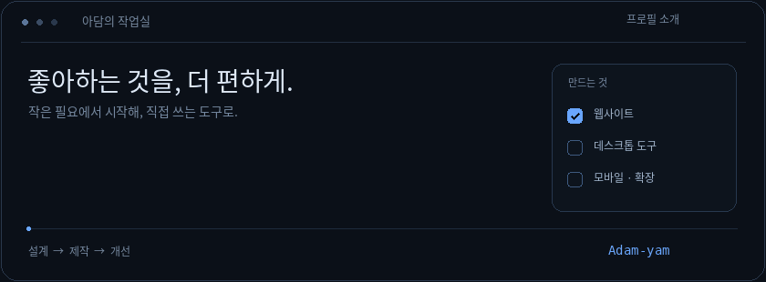

<h1 align="center">안녕하세요, 아담입니다.</h1>

좋아하는 것을 더 쉽게 즐기고, 일상의 작은 불편을 줄이는 도구를 만듭니다. 팬들을 위한 웹사이트부터 데스크톱 프로그램, 모바일 앱, 브라우저 확장까지.

<a href="https://adam-yam.github.io/SCENE-FLIX/">센플릭스 방문</a> &nbsp; · &nbsp; <a href="https://www.youtube.com/@SCENE-FLIX1">유튜브</a> &nbsp; · &nbsp; <a href="https://github.com/Adam-yam?tab=repositories">전체 저장소</a>

 

## 작은 필요에서 시작합니다

찾고 싶은 영상이 여기저기 흩어져 있거나, 자주 쓰는 기능에 접근하기 번거롭거나, 매일 보는 화면을 조금 바꾸고 싶을 때가 있습니다. 그런 순간에 직접 쓸 수 있는 것을 만들어 봅니다.

리센느를 좋아하는 리마인으로서 **SCENE-FLIX**를 운영하고 있습니다. 필요한 콘텐츠를 한곳에 정리하고, 팬들과 더 편하게 공유할 수 있는 방법을 고민합니다. 그 밖에도 키보드 입력에 반응하는 캐릭터, 지문 관련 설정을 여는 앱, 유튜브 시청 환경을 바꾸는 확장 프로그램처럼 관심 있는 것들을 하나씩 만들어 가고 있습니다.

| 관심 분야 | 만들고 싶은 경험 |
| :--- | :--- |
| 팬 콘텐츠와 커뮤니티 | 흩어진 콘텐츠를 쉽게 찾고 함께 즐기는 공간 |
| 일상 속 작은 도구 | 반복하거나 번거로웠던 작업을 줄이는 기능 |
| 화면과 상호작용 | 필요한 정보는 잘 보이고 움직임은 자연스러운 인터페이스 |

 

## 대표 프로젝트

### 01 &nbsp; SCENE-FLIX

**리센느의 영상을 찾고, 모아 보고, 다시 꺼내 보는 공간**

음악방송부터 외부 콘텐츠, 자체 콘텐츠와 팬튜브까지 리센느 관련 영상을 한곳에서 탐색할 수 있는 웹사이트입니다. 여러 채널을 오가며 영상을 찾는 수고를 줄이고, 보고 싶은 콘텐츠에 빠르게 도달할 수 있도록 구성했습니다.

- **콘텐츠 탐색** — 분류와 검색으로 영상을 찾고, 시리즈 콘텐츠를 모아 볼 수 있습니다.
- **팬 활동에 필요한 정보** — 스케줄과 뉴스, 차트 등 관련 정보를 함께 확인합니다.
- **나만의 모아보기** — 즐겨찾기로 다시 볼 영상을 정리합니다.
- **기기에 맞춘 화면** — PC와 모바일에서 각각 보기 편한 화면과 메뉴를 제공합니다.

웹사이트 · 팬 콘텐츠 아카이브

[사이트 방문 ↗](https://adam-yam.github.io/SCENE-FLIX/) &nbsp; [저장소 보기 ↗](https://github.com/Adam-yam/SCENE-FLIX)

 

### 02 &nbsp; Typing Remini

**키보드를 두드리는 순간, 바탕화면에 작은 반응을 더합니다**

레미니 캐릭터가 키보드 입력에 반응하는 데스크톱 프로그램입니다. 작업하는 동안에는 함께 타이핑하고, 한동안 입력이 없으면 졸거나 잠드는 모습으로 바탕화면에 소소한 재미를 더합니다.

- **캐릭터 선택** — 여러 레미니 캐릭터의 2D·3D 표현을 선택합니다.
- **입력과 대기 모션** — 타이핑과 무입력 상태에 따라 캐릭터가 다르게 반응합니다.
- **움직임 설정** — 통통 튀는 효과를 취향에 맞게 조절합니다.
- **사용 편의 기능** — 게임 모드와 업데이트 확인 기능을 제공합니다.

Windows · 데스크톱 캐릭터

[저장소 보기 ↗](https://github.com/Adam-yam/Typing-Remini) &nbsp; [배포 파일 보기 ↗](https://github.com/Adam-yam/Typing-Remini/releases)

 

### 03 &nbsp; SenseTouch

**삼성 기기의 지문 인식률 향상 기능에 더 쉽게 접근합니다**

지원되는 삼성 기기에서 숨겨진 지문 관련 설정 화면을 호출하는 Android 앱입니다. Shizuku 연결과 권한 상태를 확인하고, 필요한 기능을 간결한 화면에서 실행할 수 있도록 만들었습니다.

- **연결 상태 확인** — Shizuku 연결 여부와 실행에 필요한 권한을 확인합니다.
- **기기 지원 확인** — 삼성 기기와 시스템 환경에 따른 지원 여부를 점검합니다.
- **지문 선택과 실행** — 지문 항목을 선택해 관련 기능을 호출합니다.
- **실패 상황 안내** — 실행할 수 없는 경우 원인을 파악할 수 있도록 안내합니다.

Android · 삼성 기기용 도구

기기와 One UI 버전에 따라 지원 여부가 달라질 수 있습니다. 지문 인식률의 일정한 개선을 보장하는 앱은 아닙니다.

[저장소 보기 ↗](https://github.com/Adam-yam/SenseTouch) &nbsp; [배포 파일 보기 ↗](https://github.com/Adam-yam/SenseTouch/releases)

 

### 04 &nbsp; Ambient Light for YT · KR

**유튜브 영상의 색을 화면 주변까지 자연스럽게 확장합니다**

기존 Ambient Light for YouTube를 바탕으로 한국어 설정과 사용 편의성을 다듬은 브라우저 확장 프로그램입니다. 영상 주변의 앰비언트 효과를 원하는 분위기에 맞게 설정할 수 있습니다.

- **한국어 설정 화면** — 효과와 옵션을 이해하기 쉽게 정리했습니다.
- **프리셋 선택** — 설정값을 하나씩 조절하지 않고 원하는 분위기를 선택합니다.
- **세부 조절** — 흐림과 확산 범위 등 시각 효과를 취향에 맞게 조정합니다.
- **실시간 적용** — 영상을 보면서 설정 변경을 확인할 수 있습니다.

브라우저 확장 · 한국어화 및 사용성 개선

[저장소 보기 ↗](https://github.com/Adam-yam/Ambient_Light_for_YT_KR)

 

### 05 &nbsp; SCENE-grid

**내 이미지를 갤럭시 빠른 설정 패널에 맞는 그리드로 나눕니다**

삼성 갤럭시 One UI의 빠른 설정 패널을 꾸밀 때 사용할 이미지를 격자로 분할하는 도구입니다. Good Lock의 QuickStar를 활용한 화면 꾸미기에 맞춰, 이미지 조각을 준비하는 작업을 돕습니다.

- **이미지 분할** — 한 장의 이미지를 정해진 격자에 맞는 조각으로 나눕니다.
- **커스터마이징 준비** — 빠른 설정 패널에 사용할 이미지 구성을 준비합니다.

이미지 도구 · 갤럭시 커스터마이징

[저장소 보기 ↗](https://github.com/Adam-yam/SCENE-grid)

 

## 만들면서 중요하게 생각하는 것

**직접 쓰고 싶은 기능** 
작은 기능이라도 실제로 사용할 이유가 있는지부터 생각합니다. 제가 쓰면서 발견한 불편과 사용자들의 의견을 개선의 출발점으로 삼습니다.

**덜 복잡한 화면** 
메뉴와 설명을 무작정 늘리기보다 필요한 기능에 쉽게 접근하도록 정리합니다. PC와 모바일의 차이, 글자의 가독성과 버튼의 크기도 함께 살펴봅니다.

**자연스러운 움직임** 
애니메이션은 화면을 꾸미는 요소이면서, 입력과 상태 변화를 알려 주는 수단이라고 생각합니다. 반복해서 보아도 부담스럽지 않은 움직임을 지향합니다.

**계속 다듬는 과정** 
만드는 것에서 끝내지 않고 사용 중 발견한 오류, 불필요한 코드, 불편한 동작을 차근차근 정리해 나가려고 합니다.

 

## 사용해 보고 이야기해 주세요

버그를 발견했거나 추가되었으면 하는 기능이 있다면 **해당 프로젝트 저장소의 이슈**에 남겨 주세요. 사용한 기기와 프로그램 버전, 문제가 발생한 상황을 함께 적어 주시면 확인하는 데 도움이 됩니다.

각 프로젝트의 설치 방법과 지원 환경, 배포 파일은 해당 저장소의 안내를 확인해 주세요.

<a href="https://github.com/Adam-yam?tab=repositories">다른 프로젝트 둘러보기 ↗</a>

 

좋아하는 마음으로, 아담이 만듭니다.

